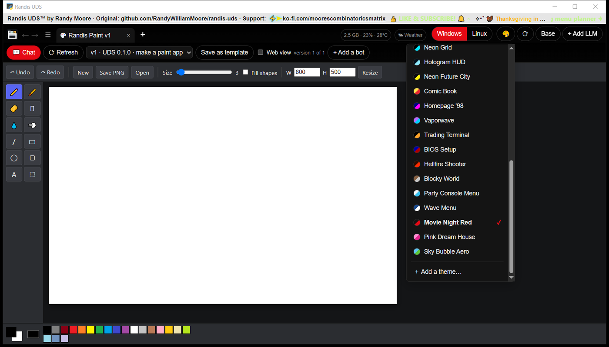

# Randis UDS™

**Randis UDS™ by Randy Moore. This is the original.** Repository: https://github.com/RandyWilliamMoore/randis-uds · Support: https://ko-fi.com/moorescombinatoricsmatrix

[](https://youtu.be/VZeMAVmKJrY)

**[Watch the walkthrough video](https://youtu.be/VZeMAVmKJrY)**

**[Play games and apps made with Randis UDS in The Randis Shop](https://randywilliammoore.github.io/randis-shop/)**

Copies, clones and derivatives must say so at the very top of their work and link back to the original repository: see `NOTICE.md`.

**Randis UDS™ is a universal software with no fixed purpose. Describe what you need, and the LLM inside it builds that into the app while you're using it. If you can dream it you can build it.**



Link a local model or an online account to start. With no LLM linked, it works as a notepad and text editor.

Status: pre-release. Windows has an installer. Linux runs from source, tested on Ubuntu 24.04: see [Linux](#linux).

Like it? Support the author: https://ko-fi.com/moorescombinatoricsmatrix

Find real in-game items here: https://www.etsy.com/shop/UberRandis

If you would like to be a sponsor or host your items, goods, and products on my store, [contact me](#contact).

Join the Discord: https://discord.gg/83RmuHcQTR

YouTube: https://www.youtube.com/@Randis9000 and https://www.youtube.com/@MooresCombinatoricsMatrix

## What it does

- Browser-style tabs, including dragging a tab into its own window
- Chat with a linked LLM: a local model, LM Studio, your own Anthropic API key, or Claude Code on this computer
- Build tabs by chat, keep their versions, and save any of them as a template. Each built tab has its own chat beside it: ask about the tab, report a bug or ask for a change, and it can ask you questions back
- A built tab can save files it makes, like a song, a video or a picture, wherever you pick
- An IDE tab, a notepad, and a rubber duck you can restyle, pop out or talk a problem through with
- A PDF tab: read, make from text or pictures, merge, rotate, reorder, and add a drawn or typed signature (a picture on the page, not a certificate signature)
- A snapshot before every Claude Code turn, so each turn can be undone
- Projects: separate copies of the app for separate work, with changes from Base pushed into them
- Online play for built tabs: a game can link to a friend's copy with a private invite code (see below)
- Bots: "+ Add a bot" on any tab, or for the whole app, makes a small helper that reads and reports, managed in the Bots tab (see below)
- Skins: the 🎨 button in the tab bar restyles the whole app with any of the 29 Randis Shop skins, or with a theme of your own ("+ Add a theme…": your colours and font, ✎ to change it). Your pick stays after a restart

New in 0.1.16:

- Every game and app in the Randis Shop comes ready in the installer as its own tab, in its section with its icon (25 games, 39 apps)
- MCM Software support (its AI helper) and 15 more Randis Emoji tab icons

New in 0.1.15:

- Skins menu (🎨) for the whole app, with your own themes
- The skins have their own names and joke badges (Half-Baked, Notflix, Pear OS, Waffles 95 and more) instead of other companies' names and logos

New in 0.1.14:

- Tab sections: the + menu groups built tabs (Games, Create, Learn, Tools, Money & Shop, Bots & AI, Life & Family) in folds that remember how you left them, and every tab has its own icon from the Randis Emoji set
- Ship button: a built tab with changes your shop doesn't have yet shows a green **Ship** button that stays lit until they're shipped. Pressing it with nothing new says so
- Hidden credit mark: files a built tab saves out, and tabs shipped to a shop, carry a one-line "Made with Randis UDS" note no viewer shows (see `NOTICE.md`)
- Support for the new suites in [The Randis Shop](https://randywilliammoore.github.io/randis-shop/): Game Emulator Suite (EmulatorJS, fetched once from its own site the first time you play, then offline), VM Suite (real PCs in a tab with QEMU), Shop Studio (your own shop on GitHub Pages), Codex Academy (lessons and a code runner), Randis Antivirus, Media Network and Repo Scout
- Voice: tabs can talk and listen; weather; spell check in chat boxes

## Contact

- Leave a comment: https://github.com/RandyWilliamMoore/randis-uds/discussions
- Discord: https://discord.gg/83RmuHcQTR
- Ko-fi: https://ko-fi.com/moorescombinatoricsmatrix

Comments here are public, so please leave out anything private.

## Install

Run `RandisUDS-Setup-<version>.exe`. It installs for your user only, with no admin rights, brings its own Python, and adds a desktop icon. The first time you open it, a window shows you how to pin it to your taskbar and connect Claude Code. Windows may warn about an unknown publisher because the installer isn't signed yet.

Running a newer setup over an install updates it. Your data stays, and any app code you or your Claude changed is saved to `data\edited_before_update` before the new code goes in.

Or update from inside the app: open the Menu (☰) and press **Update Randis UDS**. It checks this repo's releases, and asks before it downloads anything. Then it closes, installs the new version the same way, and opens again. **Check for updates automatically**, in the same place, checks every few hours and asks when there's a new version. It's on to start with. Only an installed copy updates itself. A copy run from source doesn't.

The local GGUF link also needs `llama-cpp-python`, which isn't bundled. LM Studio, an Anthropic API key and Claude Code links don't.

## Edit it with Claude Code

Claude Code can change Randis UDS from outside the app, and fix it if it ever won't start. `CLAUDE_CODE_SETUP.md` takes you from Claude in your browser to Claude Code in PowerShell, including your account and permissions. Claude then starts from `CLAUDE.md`, which walks it through the rest. A snapshot is saved before each message, so each turn can be undone.

## Run from source

Needs Python 3.14 and the Microsoft Edge WebView2 runtime (already on most Windows 10 and 11 PCs).

```powershell
pip install -r requirements.txt
python launch.py
```

Optional: Git for Projects, and Claude Code for the Claude Code link.

API keys are stored in `%APPDATA%\RandisUDS`, encrypted with Windows' per-user encryption. They are not stored in this folder.

## Linux

Runs from source; there's no installer yet. Tested on Ubuntu 24.04.

```bash
sudo apt install python3-venv python3-gi python3-gi-cairo gir1.2-gtk-3.0 gir1.2-webkit2-4.1
./run_linux.sh
```

The first run sets up `.venv` in this folder. What's different from Windows:

- Tabs and the duck can't reach the internet here either, but the block is built differently: the Linux web view ignores the rule Windows uses, so each window gets a content filter that refuses every request except to the app's own page, a check that stops any frame leaving for another address, and WebRTC turned off (`linux_wall.py`). `tests/wall_test.py` runs the same attacks on both.
- API keys are stored in `~/.config/RandisUDS/keys.json`, readable only by your user, but not encrypted.
- No taskbar pinning help, and the Claude Code setup opens in your terminal instead of PowerShell.

## Publishing songs to your own shop

A tab that makes music (like Randis Sound Forge, in the Randis Shop) can publish a song to a shop you run, as a tagged MP3 with a cover, if you set it up. Make `data/publish.json`:

```json
{"shop_folder": "C:/path/to/your-shop-checkout", "shop_name": "My Shop", "by": "Your name", "page": "https://you.github.io/your-shop/#/music"}
```

The shop folder is a git checkout of a shop like [the Randis Shop](https://github.com/RandyWilliamMoore/randis-shop), with its `tools/add_music.py`, that can push. Publishing needs [ffmpeg](https://ffmpeg.org/). Each time, Randis UDS asks you first, then adds the song and pushes only that. Without the file, tabs never see a Publish button.

## Bots

Every tab has a **+ Add a bot** button, and the Bots tab (in the + menu) has one for the whole app. Type what the bot should do, in a sentence; that's its job and your yes. Before anything is made, the form says which folder the bot can read: the tab's own (a built tab's versions, an IDE tab's project, a saved note's folder) or the app's.

- Bots run on your own Claude Code, so each run uses your Claude plan. Without Claude Code installed, the form says how to get it.
- A bot can only read and search that folder. It can't change, delete or send anything; it reports in the Bots tab.
- Each run is on its own: from the bot's own folder in your app-data folder, with no saved session, no settings, hooks or connectors, and none of the Claude variables of whatever started Randis UDS.
- In the Bots tab: Run once, Start (keeps running on its schedule), Stop and Retire, with each bot's light, last answer, today's record and the latest messages.
- At most two bots run at once, none start when free memory is under 1 GB, and every bot stops when Randis UDS closes.

## Online play

A built tab stays walled off from the internet. A game in one can still play a friend: the first time it asks, Randis UDS asks you whether to allow online play for that tab, and keeps your answer. One player hosts and gets a private invite code, the other types it in. Every message is sealed with AES-256-GCM, using a key made from the code, before it leaves the app; the app only carries the sealed text through a free public MQTT relay (broker.emqx.io, broker.hivemq.com or test.mosquitto.org) over TLS. The relay can't read what's sent, but it can see that two copies are talking and when. Anyone with the code can join, so send it privately.

## Tests

```powershell
pip install pillow
python tests/tabs_test.py --no-real
python tests/restore_test.py
python tests/projects_test.py
python tests/tabbar_test.py
python tests/tab_icons_test.py
python tests/load_retry_test.py
python tests/launch_test.py
python tests/origin_test.py
python tests/first_run_test.py
python tests/pdf_test.py
python tests/ui_test.py --no-real
python tests/item_test.py
python tests/bots_test.py
python tests/bots_real_test.py    # one real bot run with your Claude Code (a few seconds of your plan)
python tests/net_test.py          # needs the internet: it uses a real public relay
# the tests below for the shop's suites (emu, scout, codelab, av, media) also open that tab, so put it in data/tabs first
python tests/emu_test.py <Game Emulator Suite page>.html   # the offline emulator (EmulatorJS); the first run fetches its files once
python tests/vm_test.py           # TempleOS tab and VM Suite (vm.py); boots TempleOS if QEMU is installed. Add "download" to also fetch and boot Tiny Core Linux
python tests/studio_test.py       # the Shop Studio and shops in the Shop tab, against a pretend GitHub on this computer (needs Git)
python tests/scout_test.py        # Repo Scout: address rules, which tabs may use it, and the tab with real searches ("offline" skips the web part)
python tests/codelab_test.py      # Codex Academy: the code runner, every exercise's answer key, and the tab in a browser ("quick" skips the last two)
python tests/av_test.py           # Randis Antivirus: detections, false-alarm guards, quarantine round trip, and the tab in a browser ("quick" skips the browser)
python tests/tab_sections_test.py # tab sections, tab icons, Emoji Forge in the + menu
python tests/credit_mark_test.py  # the hidden credit mark, and the Ship button against a pretend shop (needs Git)
python tests/appskins_test.py     # the 🎨 skins menu and your own themes in a browser; no brand names in the skins ("quick" skips the browser)
python tests/media_test.py        # Media Network: voices, audio joining, feeds, outlet secrets kept outside the folder, and the tab in a browser ("offline"/"quick" skip parts)
```

## Known issues

- Sometimes a page reload doesn't finish loading, and your open tabs don't come back. Automated tests show this now and then on a new install. The cause isn't known yet.
- Undoing a Claude Code turn puts the whole folder back to how it was before that turn, including any other changes made since then.
- Tabs can't reach the internet, but when the rubber duck is popped out to its own window, a duck page that sends its window to another address can sometimes get that one request out.

## License

GNU General Public License, version 3: see `LICENSE`. Copyright (C) 2026 Randy Moore.

Every copy, clone or derivative must show that it came from Randis UDS and link back to the original repository and to the author's support page, every time it runs: see the additional terms in `NOTICE.md`. The name Randis UDS™ and the logos aren't covered by the GPL, and parts by others keep their own licenses: see `NOTICE.md`.
