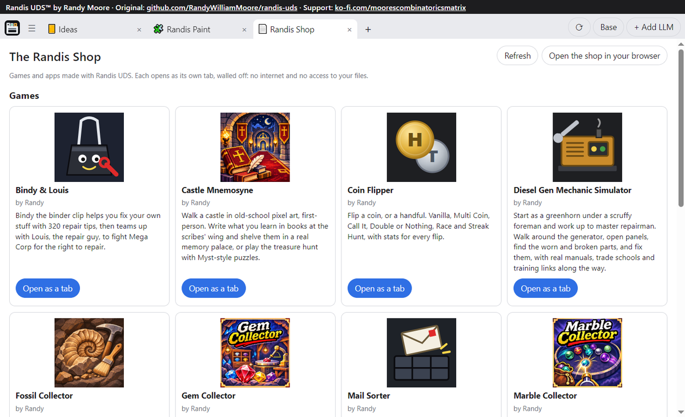

# Randis UDS™

**Randis UDS™ by Randy Moore. This is the original.** Repository: https://github.com/RandyWilliamMoore/randis-uds · Support: https://ko-fi.com/moorescombinatoricsmatrix

[](https://youtu.be/VZeMAVmKJrY)

**[Watch the walkthrough video](https://youtu.be/VZeMAVmKJrY)**

**[Play games and apps made with Randis UDS in The Randis Shop](https://randywilliammoore.github.io/randis-shop/)**

Copies, clones and derivatives must say so at the very top of their work and link back to the original repository: see `NOTICE.md`.

**Randis UDS™ is a universal software with no fixed purpose. Describe what you need, and the LLM inside it builds that into the app while you're using it. If you can dream it you can build it.**



Link a local model or an online account to start. With no LLM linked, it works as a notepad and text editor.

Status: pre-release. Windows has an installer. Linux runs from source, tested on Ubuntu 24.04: see [Linux](#linux).

Like it? Support the author: https://ko-fi.com/moorescombinatoricsmatrix

Find real in-game items here: https://www.etsy.com/shop/UberRandis

If you would like to be a sponsor or host your items, goods, and products on my store, [contact me](#contact).

Join the Discord: https://discord.gg/83RmuHcQTR

YouTube: https://www.youtube.com/@Randis9000 and https://www.youtube.com/@MooresCombinatoricsMatrix

## What it does

- Browser-style tabs, including dragging a tab into its own window
- Chat with a linked LLM: a local model, LM Studio, your own Anthropic API key, or Claude Code on this computer
- Build tabs by chat, keep their versions, and save any of them as a template. Each built tab has its own chat beside it: ask about the tab, report a bug or ask for a change, and it can ask you questions back
- A built tab can save files it makes, like a song, a video or a picture, wherever you pick
- An IDE tab, a notepad, and a rubber duck you can restyle, pop out or talk a problem through with
- A PDF tab: read, make from text or pictures, merge, rotate, reorder, and add a drawn or typed signature (a picture on the page, not a certificate signature)
- A snapshot before every Claude Code turn, so each turn can be undone
- Projects: separate copies of the app for separate work, with changes from Base pushed into them
- Online play for built tabs: a game can link to a friend's copy with a private invite code (see below)

## Contact

- Leave a comment: https://github.com/RandyWilliamMoore/randis-uds/discussions
- Discord: https://discord.gg/83RmuHcQTR
- Ko-fi: https://ko-fi.com/moorescombinatoricsmatrix

Comments here are public, so please leave out anything private.

## Install

Run `RandisUDS-Setup-<version>.exe`. It installs for your user only, with no admin rights, brings its own Python, and adds a desktop icon. The first time you open it, a window shows you how to pin it to your taskbar and connect Claude Code. Windows may warn about an unknown publisher because the installer isn't signed yet.

Running a newer setup over an install updates it. Your data stays, and any app code you or your Claude changed is saved to `data\edited_before_update` before the new code goes in.

Or update from inside the app: open the Menu (☰) and press **Update Randis UDS**. It checks this repo's releases, and asks before it downloads anything. Then it closes, installs the new version the same way, and opens again. **Check for updates automatically**, in the same place, checks every few hours and asks when there's a new version. It's on to start with. Only an installed copy updates itself. A copy run from source doesn't.

The local GGUF link also needs `llama-cpp-python`, which isn't bundled. LM Studio, an Anthropic API key and Claude Code links don't.

## Edit it with Claude Code

Claude Code can change Randis UDS from outside the app, and fix it if it ever won't start. `CLAUDE_CODE_SETUP.md` takes you from Claude in your browser to Claude Code in PowerShell, including your account and permissions. Claude then starts from `CLAUDE.md`, which walks it through the rest. A snapshot is saved before each message, so each turn can be undone.

## Run from source

Needs Python 3.14 and the Microsoft Edge WebView2 runtime (already on most Windows 10 and 11 PCs).

```powershell
pip install -r requirements.txt
python launch.py
```

Optional: Git for Projects, and Claude Code for the Claude Code link.

API keys are stored in `%APPDATA%\RandisUDS`, encrypted with Windows' per-user encryption. They are not stored in this folder.

## Linux

Runs from source; there's no installer yet. Tested on Ubuntu 24.04.

```bash
sudo apt install python3-venv python3-gi python3-gi-cairo gir1.2-gtk-3.0 gir1.2-webkit2-4.1
./run_linux.sh
```

The first run sets up `.venv` in this folder. What's different from Windows:

- Tabs and the duck can't reach the internet here either, but the block is built differently: the Linux web view ignores the rule Windows uses, so each window gets a content filter that refuses every request except to the app's own page, a check that stops any frame leaving for another address, and WebRTC turned off (`linux_wall.py`). `tests/wall_test.py` runs the same attacks on both.
- API keys are stored in `~/.config/RandisUDS/keys.json`, readable only by your user, but not encrypted.
- No taskbar pinning help, and the Claude Code setup opens in your terminal instead of PowerShell.

## Publishing songs to your own shop

A tab that makes music (like Randis Sound Forge, in the Randis Shop) can publish a song to a shop you run, as a tagged MP3 with a cover, if you set it up. Make `data/publish.json`:

```json
{"shop_folder": "C:/path/to/your-shop-checkout", "shop_name": "My Shop", "by": "Your name", "page": "https://you.github.io/your-shop/#/music"}
```

The shop folder is a git checkout of a shop like [the Randis Shop](https://github.com/RandyWilliamMoore/randis-shop), with its `tools/add_music.py`, that can push. Publishing needs [ffmpeg](https://ffmpeg.org/). Each time, Randis UDS asks you first, then adds the song and pushes only that. Without the file, tabs never see a Publish button.

## Online play

A built tab stays walled off from the internet. A game in one can still play a friend: the first time it asks, Randis UDS asks you whether to allow online play for that tab, and keeps your answer. One player hosts and gets a private invite code, the other types it in. Every message is sealed with AES-256-GCM, using a key made from the code, before it leaves the app; the app only carries the sealed text through a free public MQTT relay (broker.emqx.io, broker.hivemq.com or test.mosquitto.org) over TLS. The relay can't read what's sent, but it can see that two copies are talking and when. Anyone with the code can join, so send it privately.

## Tests

```powershell
pip install pillow
python tests/tabs_test.py --no-real
python tests/restore_test.py
python tests/projects_test.py
python tests/tabbar_test.py
python tests/tab_icons_test.py
python tests/load_retry_test.py
python tests/launch_test.py
python tests/origin_test.py
python tests/first_run_test.py
python tests/pdf_test.py
python tests/ui_test.py --no-real
python tests/item_test.py
python tests/net_test.py          # needs the internet: it uses a real public relay
```

## Known issues

- Sometimes a page reload doesn't finish loading, and your open tabs don't come back. Automated tests show this now and then on a new install. The cause isn't known yet.
- Undoing a Claude Code turn puts the whole folder back to how it was before that turn, including any other changes made since then.
- Tabs can't reach the internet, but when the rubber duck is popped out to its own window, a duck page that sends its window to another address can sometimes get that one request out.

## License

GNU General Public License, version 3: see `LICENSE`. Copyright (C) 2026 Randy Moore.

Every copy, clone or derivative must show that it came from Randis UDS and link back to the original repository and to the author's support page, every time it runs: see the additional terms in `NOTICE.md`. The name Randis UDS™ and the logos aren't covered by the GPL, and parts by others keep their own licenses: see `NOTICE.md`.
